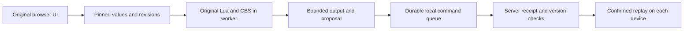

# Original display Lua in browser workers

The shared frozen scope follow-up is documented in [display-scope-cache-runtime.md](display-scope-cache-runtime.md). Prior worker and transfer measurements retain their historical scope; the full goal remains active.

Transfer follow-up: [Worker transfer and exact byte budget](display-wire-runtime.md) sends pinned plain values directly, normalizes JSON inside the worker and retains the 16 MiB boundary through bounded primitive-length caching. Worker measurements in this document remain historical observations from 5784193.

Follow-up: [Display capture and concurrent presentation scope](display-capture-runtime.md) adds a no-Lua fast path and preserves row-index/history/admission distinctions in the in-flight key. The worker measurements below are historical observations from commit 5784193.

This is a local implementation milestone within the original server-generation, relational-storage and multiple-device goal. All 15 completion requirements remain in scope and unchecked. The configured full user trial is unfinished. Production, private content and remote repositories were not accessed or changed.

The entity UI now executes original display Lua in a dedicated browser worker for each chat/code lease. `DisplayLuaContext` retains the original scripting factory, variable helpers, nested CBS, private Lua globals and proposal tracking. The browser manager retains coalescing, lease order/LRU, local admission and server receipts. The legacy application path is unchanged.



Nested JSON containers and revision maps are copied before the first asynchronous boundary. Immutable scalar strings are reused; JSON stringify/parse at this boundary duplicated loaded history for every row and caused a new long task. Serialization into the worker happens after the existing task yield. It stores the private character/chat once and restores their aliases in the worker. There is no snapshot cache keyed only by cursor: pagination, drafts or other visible-state changes can alter the read scope without a new canonical cursor.

## Limits and cancellation

| Boundary            | Policy                                                                                              |
| ------------------- | --------------------------------------------------------------------------------------------------- |
| Leases / queue      | At most 8 contexts and 128 invocations per context; idle LRU contexts are terminated                |
| Snapshot            | JSON containers; at most 200,000 visited values / depth 128                                         |
| Transferred scope   | At most 16 MiB UTF-8 JSON                                                                           |
| Initialization      | 10 seconds for worker module, WASM and original JSON library; resource failure is visible           |
| Invocation          | 2,000 ms after initialization; includes script, RPC and result processing                           |
| Output              | Text only, at most 4 MiB; invalid/oversized output rejects the proposal                             |
| Persistent proposal | Existing maximum 128 reads/writes and 256 KiB; original scalar variable rules and server CAS remain |
| Logging             | At most 16 bounded diagnostic messages per invocation; original source dumps are not relayed        |

The owner's timer terminates a worker on timeout. Closing the owner terminates all workers, rejects active work and prevents queued work from starting or a late result from entering IDB. A failed worker is retired; its queued invocations return their original presentation and do not replay computation automatically. A later render may create a fresh VM. Missing/blocked workers fail visibly instead of executing Lua on the UI thread.

These are browser scheduling budgets, not operating-system CPU/heap limits. A frozen or throttled owner can delay its timer. Lua can allocate memory before termination; no hard Lua heap quota has been established. Server generation and already admitted durable commands remain independent of presentation/tab lifetime. A presentation effect closed before local admission is discarded, not guaranteed to finish in the background.

## Original API scope

The worker uses the original scripting factory and captured CBS module/lore/model/environment data. Lua globals remain scoped to the chat/code lease. Original editDisplay token rules remain: Safe/LowLevel operations keep their existing guards. Nested variables, JSON state, lore lookup, hashing and original character/persona image helpers are retained. No general browser host, network or DOM RPC is exposed.

Image helpers use two narrow asynchronous ports: read a captured character/persona image, then call the existing browser inlay writer with a worker Blob URL. They preserve the current image API behavior, but browser canvas/inlay work still occurs on the UI thread. An already started inlay write cannot be rolled back or fully cancelled with the canonical variable proposal; local inlay storage and complete shared-asset/alias/lifetime semantics remain unfinished. Port failure is sticky even if the original image helper catches it. Partial history remains an explicit capability error rather than pretending that a loaded page is the complete chat.

This does not complete outer display CBS/regex/plugin scope, complete-history APIs, all original extension semantics or persistent collection policies. The factory audit still reports 160 selected declarations: 158 unchanged plus the two existing, explicitly pinned invocation cleanup/error policies. Worker host/lifetime/budget policies are additional adapter behavior, not proof that every original application behavior is identical.

## Reproduction and measured scope

`displayWorkerUi.test.cjs` launches the actual original UI and a real WASM worker. It clicks the original checkbox during an infinite loop, verifies continuing RAF and real toggle admission, then checks timeout, no partial proposal, owner cancellation, original globals/CBS/lore/hash/image recovery and invalid/oversized output rejection. Its direct worker harness captures proposals; end-to-end display IDB/server admission remains separately covered by `displayUi.test.cjs`.

`displayWorkerBuildUi.test.cjs` runs the optimized original UI bundle with real IDB/server admission. It delays the original JSON library response by 2,200 ms, proves initialization has a separate budget, clicks the real checkbox to start infinite display Lua, sees the visible 2,000 ms failure and verifies that pre-loop changes did not reach canonical storage. It requires a separately built directory; absence of the environment variable skips that test. The recorded full run supplies the build and has zero browser skips.

```bash
VITE_RISU_ENTITY_RUNTIME=TRUE VITE_RISU_LEGAL_CONFIGURED=TRUE \
  pnpm build --outDir /tmp/risu-display-worker-web
RISU_DISPLAY_WORKER_BUILD_PATH=/tmp/risu-display-worker-web \
  node --test --test-concurrency=1 server/browser/*.test.cjs
```

The large original UI fixture still performs every Lua calculation: 50 messages, 2,400 HTML cells, 16 regex rules, 600,000 iterations per invocation, 56 observed invocations including dependent redraws and 44 independently recomputed rows with stable HTML descendants. Six warm observations per scenario are retained for the worker milestone. CDP CPU throttling is configured on the page target; equal worker throttling was not established. These results must not be turned into a whole-application speedup or real-mobile claim. The earlier 30-observation scheduling comparison remains historical evidence, not a matched comparison to this worker implementation.

The current raw observations, initial JSON-copy regression and unsuccessful test/HTTP runs are preserved in workspace `evidence/display-worker-logs`. The first boundary test accidentally awaited its long-running Promise before checking the checkbox; the corrected harness starts it without awaiting. A subsequent assertion queried a global toggle in the chat-variable snapshot; it now reads the actual global target. One HTTP generation test failed while a native build ran concurrently; the unchanged suite passed after the build. Its cause remains unconfirmed. Assertions/budgets were not weakened to accept those failures.

Remaining work includes repeated per-message scope/history preparation (including the no-Lua capture fast path), broad display invalidation, outer CBS/regex/sanitation, changed HTML/DOM and large assets, complete provider/editor/format/offline/restore policies and actual mobile OS lifecycle/performance. The optimized-bundle test establishes worker loading and foreground responsiveness; it is not the complete configured user trial.
